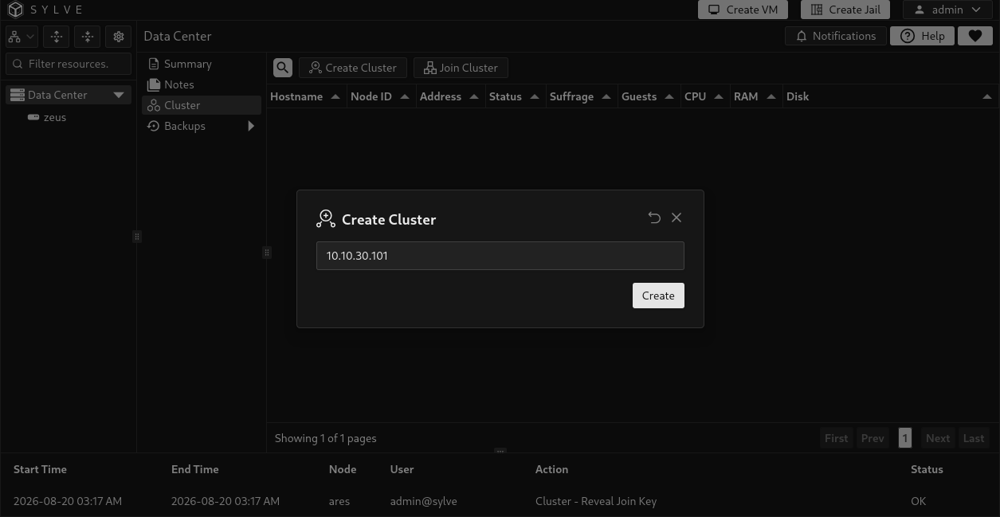
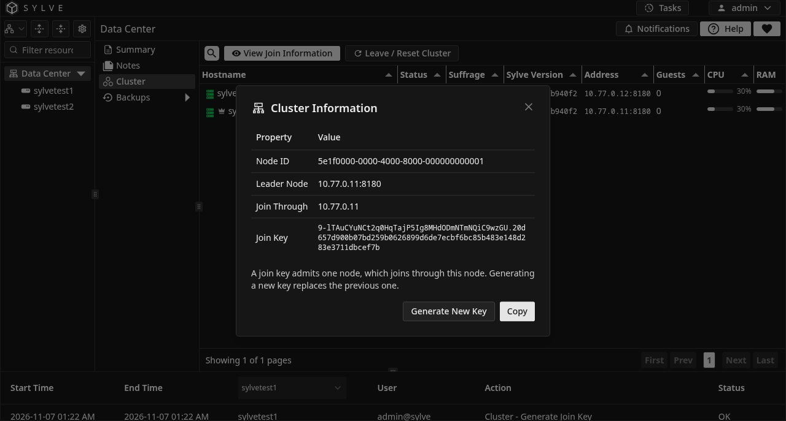
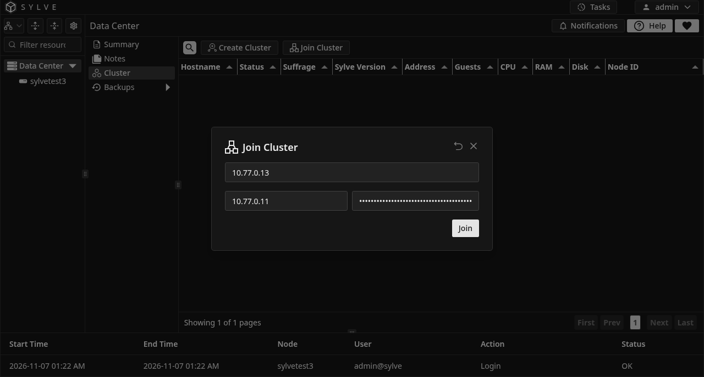
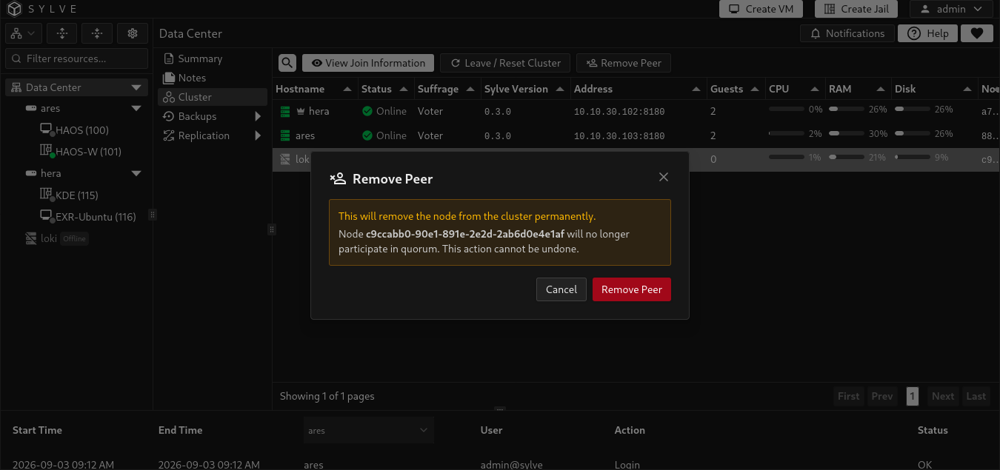
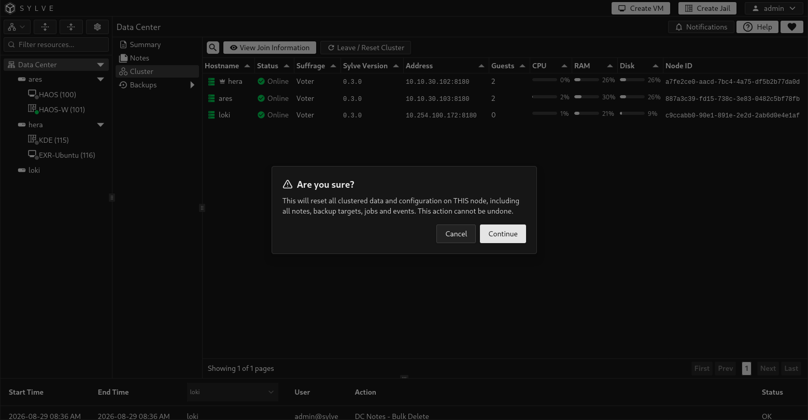

import QuorumCalculator from '../../../../../components/QuorumCalculator.astro';
import clusterOverview from './clustering-overview-v031.png';

A Sylve cluster gives you one Data Center view for its member nodes. Cluster state backs shared features such as backup targets and jobs, while each node continues to run its own workloads and services.

Sylve uses [HashiCorp Raft](https://github.com/hashicorp/raft), a battle-tested implementation of the **Raft** consensus model, to keep that shared state consistent. Raft gives the cluster a clear leader, replicated changes, and quorum-based safety when members fail or reconnect. It is a proven foundation for distributed control planes: Kubernetes commonly uses etcd, whose own distributed store is built on Raft.

Sylve does not depend on etcd. Instead, it builds its own focused control plane directly on HashiCorp Raft. This keeps the cluster stack contained and simple to operate while providing the consensus guarantees needed for Sylve's shared Data Center configuration.

Use a stable, private network between the nodes and keep every node on the same Sylve version. A three-voter cluster is the practical minimum for fault tolerance: it can retain quorum after one voter is lost. A smaller cluster can be useful for evaluation, but it cannot tolerate the same failures.

## Quorum calculator

Set the number of **voting** nodes in your planned cluster. Quorum is a strict majority of voters. Non-voting members do not increase quorum or the number of failures the cluster can tolerate.

<QuorumCalculator />

An odd voter count is usually the most efficient choice. For example, four voters still tolerate only one failure, just like three voters, while five voters can tolerate two. This calculator describes consensus availability, not workload capacity: your replica and backup design must still provide enough storage and compute capacity after a failure.

:::caution
Cluster communication is foundational infrastructure. Do not expose its internal addresses to untrusted networks, and do not treat a WAN link as equivalent to a reliable local network. Ensure every node can consistently reach the others before joining it.
:::

## Before you begin

- Decide the stable IP address each node will use for cluster communication.
- Confirm all nodes are running the same Sylve version.
- Keep the system clock synchronized on every node; a node whose clock differs from the leader by more than about 30 seconds is rejected with `cluster_join_clock_drift`. See [Keep the system clock accurate](/getting-started/) for NTP setup.
- Plan the voter count before adding production workloads. Three voters allow one voter failure without losing quorum.
- Ensure the nodes can communicate over the cluster network on `8180/TCP` for Raft, `8183/TCP` for Sylve's embedded SSH service, and `8184/TCP` for the internal cluster API.
- Give every node its own hostname. Requests for a node can name it by hostname, so a cluster refuses a node whose hostname a member already has. Fresh FreeBSD installations often share a default name; rename such a node before joining it.

### Encrypted cluster traffic

Members talk to each other over mutual TLS. Raft on `8180/TCP` and the internal cluster API on `8184/TCP` are encrypted, and each member proves its identity with its own certificate. The cluster records each member's certificate when the member joins, and only admitted members can take part. Encryption is always on and needs no configuration.

A member whose certificate changes is no longer recognized. This happens when a node is reinstalled, when its `sylve.db` is restored onto another machine, or when its cluster TLS files are deleted. Remove such a member and join it again.

## Create the first cluster node

Open **Data Center → Cluster** on the first node and select **Create Cluster**. Enter the node's cluster IP address, then confirm. That node becomes the initial Raft voter and cluster leader.



After creation, return to the Cluster page to see its member table. The leader is marked in the table, and **View Join Information** generates the join key another node needs.


## Join another node

On any member, select **View Join Information**, then **Generate Join Key**. The dialog shows the key and the address to join through, which is that member's cluster address. Copy the key before closing the dialog. It isn't shown again; generate a new one if you lose it.

A join key admits one node. Generating a new key replaces the previous one, and a completed join or any member removal spends it, so generate a key for each node you add. Treat an unused key as a credential: a node that has it and can reach that member can request admission to the cluster.

On the node to add, open **Data Center → Cluster**, select **Join Cluster**, and provide the following values.

| Field | What to enter |
| --- | --- |
| **Node IP** | The joining node's own cluster IP address. |
| **Cluster Node IP** | The **Join Through** address shown with the key: the cluster IP of the member that generated it. Enter only the address, not a URL or port. |
| **Join Key** | The key generated on that member. |

The key only works with the member that generated it. Joining through another member is refused.





Before anything changes on the joining node, Sylve checks:

- the join key;
- that both nodes run exactly the same Sylve version;
- that their clocks agree;
- that no member already has the joining node's hostname;
- that none of the joining node's VM RIDs or Jail CTIDs is claimed by another member. A VM RID and a Jail CTID with the same number conflict, even though the guest types differ.

A refused join leaves the node exactly as it was. Fix the reported problem and join again with a new key.

Once admitted, the node replaces its local copy of clustered state, such as notes, backup targets and jobs, with the cluster's. It joins as a **Non Voter**, catches up with the cluster, and the leader then promotes it to **Voter**. It doesn't affect quorum while it catches up. VMs and Jails can't be created or deleted on the joining node until it votes.

The **Cluster Join** progress control shows **Contacting Leader**, **Catching Up** and then **Awaiting Promotion**. If the cluster can't be reached, Sylve keeps the join and retries it automatically, including after a restart. The control then shows **Retrying Automatically**, with the last error under **Technical Details**. Don't reset the joining node merely because a retry is in progress. If a joining node makes no progress for 10 minutes, for example because it is switched off, the leader removes it, and the node asks to join again when it's back.

On cooperative leave, the surviving cluster releases the departing node's guest ID claims after its membership is removed. Remaining members can then use those numbers. The departed node keeps its local guests and can rejoin with any current guest set whose numeric IDs are all free in the cluster. If another node reused one of its IDs, the entire join is rejected until the conflicting local guest ID is changed or the cluster conflict is otherwise resolved. A guest deleted while standalone needs no separate release when the node returns.

## Read the member table

| Column | Meaning |
| --- | --- |
| **Hostname** | Hostname reported by the member. The cluster leader has a crown icon. |
| **Node ID** | Sylve's stable identifier for the member. |
| **Address** | The Raft address used for cluster consensus. |
| **Status** | Whether Sylve can currently see the member as online or offline. |
| **Suffrage** | The member's Raft role. A **Voter** participates in quorum; a **Non Voter** does not. A joining node is a **Non Voter** until it has caught up. |
| **Sylve Version** | Version and build commit reported by the member. The commit is shown when available. A join requires the joining node to run exactly the version of the member it joins through. |
| **Guests** | Number of guests currently associated with that member. |
| **CPU**, **RAM**, **Disk** | The member's current reported resource usage. Use these indicators when deciding where work can move before planned maintenance. |

Compare build commits as well as versions when checking an upgrade, especially with `tip` builds: two binaries can report the same release version but come from different commits. A missing commit does not prove that the builds match. You can also inspect reported commits with `sylve datacenter cluster members`; see the [Data Center CLI guide](/guides/node/cli-console/data-center/).

## Remove a peer

Only the current cluster leader can remove another member. Select a non-leader row, then select **Remove Peer**. Removing a voter immediately reduces the cluster's redundancy, so confirm that the remaining voters will still satisfy your required quorum.



The leader removes the member from Raft without contacting it first, so an offline member is removed the same way. The removed node notices within about 30 seconds, clears its clustered state, and restarts as a standalone node that keeps its guests. A node that is offline does this when it comes back.

Sylve checks cluster-owned dependencies before changing Raft membership. Removal is blocked if the node still owns or is involved in resources such as guests, backup jobs or operations, replication policies or leases, restore operations, guest operations, runner rebinds, or lifecycle tasks. The dialog lists blockers that must be resolved. If all blockers are guests, it offers **Leave and keep guests** instead of a resource list. The node is then removed and its guests stay on it. Their numeric IDs become reusable by other members once it is removed.

Removing a peer does not erase its workloads or storage. It also spends the current join key. If leadership changes while the dialog is open, refresh the Cluster page and retry on the new leader.

If a removal fails while the target is offline, the dialog offers **Force Remove…**. Use it only after externally fencing the target's power, storage, or network. Force removal removes the member and keeps its guests on it. It cannot bypass missing quorum, and other cluster-owned dependencies still block it. If the target comes back, it notices that it was removed and resets itself to a standalone node.

## Leave or reset the current node

Select **Leave / Reset Cluster** on the member that should leave. The node waits for its active changes to finish and checks that nothing in the cluster still depends on it. If it is the leader, it hands leadership to another voter. It then asks the leader to remove it, clears its local clustered state, and restarts Sylve as a standalone node. The confirmation warns that local copies of clustered notes, backup targets, jobs, and events are cleared.

The **Cluster Leave** progress control shows **Removing Membership** and then **Cleaning Local State**. If the leader can't be reached or hasn't confirmed the removal yet, the leave stays pending and is retried every few seconds. The control shows the reason. Until the leader has removed the node, **Cancel Leave** returns it to normal cluster operation. If the leave reports a problem you can fix, such as an active console or operation, resolve it and select **Retry Leave**. If a leader cannot transfer leadership, restore connectivity to another voter before retrying.

If the normal leave is blocked only by local guests, the page offers **Leave and keep guests**. The node keeps its VM and jail registrations while its clustered configuration is cleared and Sylve restarts. The surviving cluster releases those guest IDs for reuse when it removes the node. Backup jobs, replication policies and leases, active operations, and lifecycle tasks still block a leave.

A reset on a node whose join hasn't finished just resets that node.



### Force a local reset

**Force Local Reset** is available only after a leave failure. It clears this machine's local cluster state and does not remove the member from surviving Raft membership. The dialog therefore requires the local Node ID and acknowledgements that remote membership is repaired or will be repaired separately, and that duplicate workloads and shared storage are externally fenced.

Use it only when the normal leave workflow cannot be recovered. Keep the reset node isolated until its old membership is removed with **Remove Peer** on the cluster leader. The node restarts after the local reset.

### The `raft.reset` recovery flag

If a failed node was removed while offline, keep it isolated until its stale cluster state is repaired. Do not return it to the cluster network and assume that its old membership is harmless. The one-time `raft.reset` flag in `config.json` affects Raft storage only:

```json
{
  "raft": {
    "reset": true
  }
}
```

On startup with this flag, Sylve clears the old Raft storage and bootstraps a one-node Raft group. It does **not** clear the local cluster row or replicated configuration, and it does not make the node standalone. Sylve automatically changes `raft.reset` back to `false` in `config.json`. The flag alone is insufficient to prepare a safe rejoin.

:::caution
Use this flag only as part of a specific recovery procedure on a stopped node whose old membership has already been removed. Do not set it on a healthy cluster member. Use **Leave / Reset Cluster** for a normal leave, or the guarded **Force Local Reset** action after a failed leave.
:::

## Recover from losing a majority

A cluster needs a majority of its voters to elect a leader and make changes. If a majority is gone for good, for example after hardware failures, the surviving voters can't recover on their own. Stop Sylve on each survivor and run `sylve datacenter cluster recover-quorum` with the same list of surviving voters on each of them. Then start Sylve on them again. See the [Data Center CLI guide](/guides/node/cli-console/data-center/#recover-from-a-lost-majority).

:::danger
Use `recover-quorum` only for voters that will never come back. Recovering both sides of a network split separately creates two clusters.
:::

## Upgrade clustered nodes safely

For releases whose upgrade notes permit mixed-version operation, upgrade a cluster as a rolling maintenance operation, one node at a time. Keep the mixed-version period as short and quiet as possible. Sylve requires a joining node to run exactly the version of the member it joins through, but it does not reject an existing member after that member is upgraded. If a member receives a cluster change that it doesn't understand, because a newer member made it, the member stops and must be upgraded before it can continue. A rolling upgrade is therefore safe only when the release notes say so.

Release-specific upgrade notes take precedence over this general playbook. If a release requires all nodes to stop together, a particular intermediate version, or another special step, follow that instruction instead.

### Upgrade from 0.3.0 or 0.3.1

Sylve 0.3.2 changes how members store cluster state and how they authenticate each other, so it can't run in a cluster alongside 0.3.0 or 0.3.1. Instead, the cluster rebuilds itself once from the members' databases. The rebuild runs on its own:

1. Take a ZFS snapshot of the dataset that holds `dataPath` on every node. The package default is `/var/db/sylve`.
2. Let migrations, backups, restores, and replication runs finish, then stop scheduling new ones. Make no cluster changes while stopping the nodes. A 0.3.0 or 0.3.1 node doesn't record which changes its database already holds, so a change committed just before the cluster stopped can be lost.
3. Upgrade every node, ideally together. Guests keep running.
4. Each upgraded node keeps its old cluster state in `raft.pre-1` under `dataPath` and waits until a majority of the old voters is upgraded. The member with the most up-to-date state then founds the new cluster from its own database, and the others rejoin it automatically. Until then, cluster-wide operations pause: guest creation and deletion, migrations, replication scheduling, and failover.
5. Confirm in **Data Center → Cluster** that every member is online and reports the new version.

A node that is offline during the upgrade rejoins once it is upgraded and started. A rejoining node can be refused for one of two reasons:

- **Its hostname is in use:** another member already has its hostname. Rename it and restart Sylve.
- **A guest ID is in use:** one of its VM RIDs or Jail CTIDs is used on another member. Change the conflicting ID.

Either way, the node keeps running standalone, with its guests, until you fix the problem, and then it rejoins on its own.

Old cluster keys stop working; generate a join key to add a node. If a majority of the old voters is gone for good, run `recover-quorum` on a surviving node, as described in [Recover from losing a majority](#recover-from-losing-a-majority). That node then founds the new cluster from its database the next time it starts.

Rolling a rebuilt cluster back to 0.3.0 or 0.3.1 isn't supported. To go back, restore the snapshots on every node.

:::caution[Large version jumps require a coordinated outage]
Do not assume the rolling procedure below is safe for a large version jump. Releases with substantial changes to Raft commands, database schemas, or node-to-node APIs may not be compatible while different versions are running in the same cluster.

The upgrades from **0.2.3 to 0.3.0** and from **0.3.0 to 0.3.1** are such jumps. Plan a coordinated control-plane outage instead:

1. Back up the configuration and `dataPath` on every node.
2. Stop scheduled backups, migrations, and other cluster tasks.
3. Stop Sylve on every node before upgrading any node.
4. Upgrade every node while all Sylve services remain stopped. Confirm the target release's hostname, FreeBSD, configuration, and VM-management requirements from its release notes.
5. Start the voting members so the cluster can regain quorum, then start the remaining members.
6. Confirm that every node reports the same version, the cluster has a leader, and workloads and backups are healthy before resuming normal operations.

Use this coordinated procedure for any other large jump unless its release notes explicitly document a supported rolling path.
:::

### Before stopping any node

1. Read the release notes for the target version and confirm the supported upgrade path.
2. Back up `/usr/local/etc/sylve/config.json` and the configured `dataPath` on every node. The package default is `/var/db/sylve`. Use a consistent filesystem snapshot or another backup method suitable for the storage that holds it.
3. Open **Data Center → Cluster** and confirm that every expected member is online, identify the current leader, and verify that enough voters will remain online to preserve quorum.
4. Wait for migrations, backup and restore operations, replication runs, and other long-running guest tasks to finish.
5. Decide what should happen to workloads on the node. Migrate or shut down workloads that must not remain there during maintenance.

:::caution[Replication-protected guests]
A clean Sylve service shutdown fences the local replication leases and stops replication-protected VMs and jails on that node. Depending on the policy and cluster health, HA may make the workload eligible to run elsewhere. Do not stop Sylve on an active replication owner while assuming its protected guests will continue running locally.
:::

### Rolling upgrade order

Upgrade healthy followers first and the current leader last. This keeps the leader available for cluster writes during most of the maintenance and avoids an unnecessary election at the beginning. Recheck the crown icon before each node because leadership can change while the upgrade is in progress.

Never take more voters offline at once than the cluster can tolerate. In a three-voter cluster, upgrade exactly one voter at a time. A two-voter cluster loses quorum when either voter is stopped, so it cannot provide an uninterrupted rolling control-plane upgrade. Non-voting members do not contribute to quorum.

On each selected node, use either the FreeBSD package or a GitHub release binary.

On registered pkgbase hosts, **Node → System → Updates** provides approved package transactions. Standalone installations can also preview GitHub release updates there. These are node-local operations, not cluster-wide orchestration; the workload and quorum precautions above still apply.

To upgrade with `pkg`, run:

```sh
service sylve stop
pkg update
pkg upgrade sylve
service sylve start
```

Alternatively, download the binary from the [Sylve releases page](https://github.com/AlchemillaHQ/Sylve/releases). Replace `v0.3.1` with the exact target release, and replace `amd64` with `arm64` on ARM64 systems:

Only use this method for a standalone installation. If Sylve is still registered with pkg, first follow the [standalone cutover procedure](/getting-started/#switching-an-existing-pkg-installation-to-standalone), including preserving/restoring its RC script. A locked package is still package-managed.

```sh
service sylve stop
fetch https://github.com/AlchemillaHQ/Sylve/releases/download/v0.3.1/sylve-amd64 -o /tmp/sylve-new
chmod 0555 /tmp/sylve-new
mv /tmp/sylve-new /usr/local/sbin/sylve
service sylve start
```

Use the same release version and architecture-appropriate binary across every cluster member. You may upgrade to the `tip` build, but its downloadable binary can change while the reported Sylve version remains the same. Download it once and distribute that exact binary to equivalent cluster members, or compare checksums to confirm every node received the same build.

Then verify the node before moving to the next one:

```sh
service sylve status
sylve --version
```

Confirm that the service is running, the expected version is reported, and the member returns to **Online** in the Cluster table. Check the node's Summary page and Sylve logs for startup or database-migration errors. Do not continue while the upgraded node is offline, unhealthy, or repeatedly leaving and rejoining consensus.

During the mixed-version window, avoid cluster configuration changes, peer removal, backup-target changes, migrations, replication-policy changes, and manual failover unless they are required to recover the upgrade. Finish upgrading the remaining followers, then upgrade whichever node is the leader at that point.

### After every node is upgraded

- Confirm every member reports the same Sylve version and is online. Compare reported build commits too, especially when using `tip` builds.
- Confirm the cluster has a leader and the expected voter and non-voter roles.
- Review failed or interrupted tasks before resuming scheduled maintenance.
- Verify important workloads, replication policies, backup jobs, and backup targets.

An offline member during a normal upgrade is still a cluster member. Do not select **Remove Peer**, **Leave / Reset Cluster**, or set `raft.reset` merely because the service is temporarily stopped. Those are membership and recovery actions, not upgrade steps.
